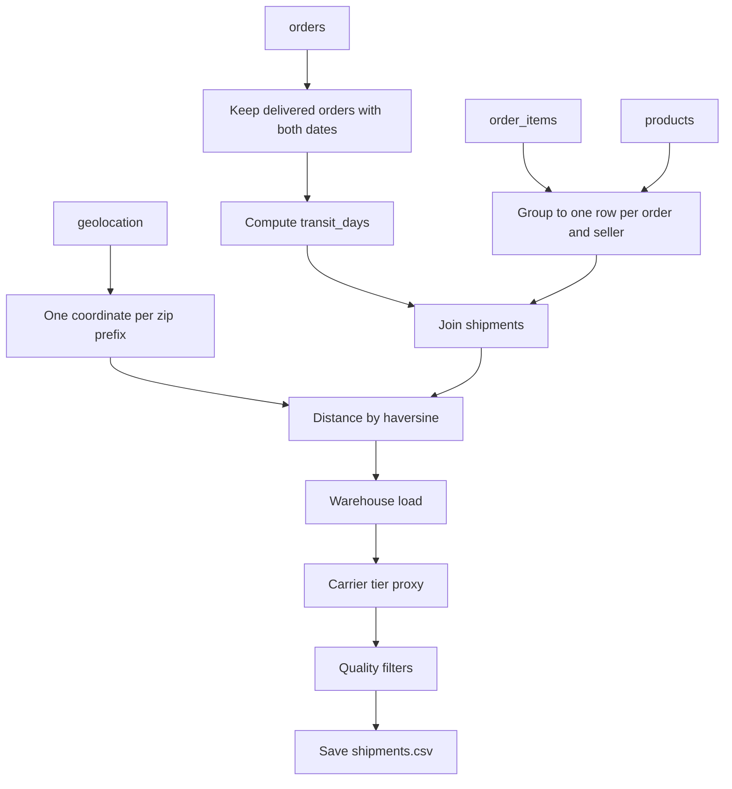

# Data Preparation Plan

**Project:** Delivery Time & Transit Delay Estimator
**Dataset:** Olist Brazilian E-Commerce (`olistbr/brazilian-ecommerce`), already in `data/raw/`
**Goal of this step:** turn six raw tables into one clean table, one row per shipment, that matches the project's schema. No EDA and no modelling happen here.

Figures below come from a quick profile of the raw files. Items marked **Decision** are proposals to confirm before we code.

---

## 1. Output We Want

One file, `data/processed/shipments.csv`, with one row per shipment (an order from one seller):

| Column | Meaning | Source |
|---|---|---|
| `order_id` | Identifier, kept for traceability. Not used as a feature. | orders |
| `seller_id` | Identifier, kept for traceability. Not used as a feature. | order_items |
| `dispatch_date` | Date the carrier received the package | orders |
| `weight_kg` | Total package weight | products |
| `distance_km` | Seller to customer straight-line distance | geolocation, sellers, customers |
| `warehouse_load` | How busy the seller was around dispatch | derived |
| `carrier_tier` | Economy / Standard / Express | derived proxy |
| `transit_days` | **Target.** Carrier pickup to customer delivery, in days | orders |

---

## 2. Source Tables

| Table | Rows | What we take |
|---|---|---|
| `olist_orders_dataset` | 99,441 | status, carrier-pickup and customer-delivery timestamps |
| `olist_order_items_dataset` | 112,650 | links order, product and seller; `freight_value` |
| `olist_products_dataset` | 32,951 | `product_weight_g` |
| `olist_customers_dataset` | 99,441 | customer zip prefix |
| `olist_sellers_dataset` | 3,095 | seller zip prefix |
| `olist_geolocation_dataset` | 1,000,163 | latitude and longitude per zip prefix |

Not used: payments, reviews, category translation.

---

## 3. Pipeline Overview

---

## 4. Steps

### Step 1: Select orders and compute the target

- Keep only `order_status = delivered` with both `order_delivered_carrier_date` and `order_delivered_customer_date` present.
- `transit_days = (customer delivery - carrier pickup)` in days, as a decimal.

**Why:** the target must be the real shipping leg. Using purchase date would mix in approval and seller handling time, which are not transit.

**Evidence:** 96,478 orders are delivered. 96,469 of them have both dates. The raw transit time has a median of 7.1 days and a mean of 9.3, with a long tail up to 205 days.

### Step 2: Build one row per shipment

- Join orders to items and products.
- Group by `order_id` and `seller_id`. Sum weights and freight across the items in that group.
- **Decision:** drop orders that involve more than one seller. A single customer-delivery date can't be attributed to a single origin for those.

**Why:** each item row is one unit of a product, so summing gives the total package weight. A package ships from one origin, so one seller per row keeps distance well defined.

**Evidence:** 9,803 orders have more than one item, and 1,278 have more than one seller.

### Step 3: Weight

- `weight_kg = product_weight_g / 1000`, summed per shipment.
- Drop shipments whose weight is missing or zero.

**Evidence:** 2 products have a missing weight and 4 have a weight of 0. The heaviest product is 40.4 kg.

### Step 4: Distance

- Geolocation has about 53 rows per zip prefix on average (1,000,163 rows for 19,015 prefixes). **Decision:** reduce it to one point per prefix using the **median** latitude and longitude, which resists stray points.
- Remove coordinates outside Brazil's bounding box before taking the median.
- Attach coordinates to the seller's and the customer's zip prefix.
- Compute the **haversine** (great-circle) distance in km.
- Drop shipments where either zip prefix has no coordinates.

**Evidence:** 42 geolocation rows lie outside Brazil's bounding box. 278 customers (of 99,441) and 7 sellers (of 3,095) have a zip prefix not in the geolocation table.

**Limitation:** this is straight-line distance, not road distance. It is a proxy for the real route.

### Step 5: Warehouse load

- **Decision:** for each shipment, `warehouse_load` = number of orders the same seller handed to the carrier on the same calendar day as this one (including itself).
- **Decision to confirm:** count over all delivered shipments, before the Step 7 quality filters are applied. Otherwise the filters would remove rows and make the counts too low.

**Why:** this is a real signal of how busy a dispatch point was. Olist has no explicit warehouse field.

**Limitation:** most sellers are small, so the value will be 1 for many shipments. If it turns out to have too little variation, the alternatives are a multi-day window or load relative to that seller's usual volume. We would decide this after a first look at the distribution, not now.

### Step 6: Carrier tier (proxy)

- **Decision:** `freight_per_kg_km = freight_value / (weight_kg × distance_km)`, then split into three bands by quantile: Economy (cheapest third), Standard, Express (most expensive third).

**Why:** Olist has no carrier field. Freight price per unit of weight and distance is the closest real signal of service level.

**Limitations to state in the README:**
- It is a proxy, not a true carrier label.
- Freight cost is partly set by weight and distance, so the tier overlaps with those two features.
- The tier is derived from price, so it must never be built using the target.

### Step 7: Quality filters

Applied after the columns exist, each with a logged count of rows removed.

| Rule | Reason | Evidence |
|---|---|---|
| `transit_days < 0` | Delivery before pickup is a data error | 23 orders |
| `transit_days` above a cap | Extreme tail is likely data or lost-package cases | 225 orders above 60 days |
| `weight_kg` missing or 0 | Not a valid package | 6 products |
| `distance_km` missing | No coordinates | 278 customer and 7 seller zips affected |
| Duplicate `order_id` + `seller_id` | One row per shipment | to check |

**Decision:** the transit cap. A starting point is 60 days. It can be revisited during EDA, since the data is saved before the cap is applied (see Step 8).

### Step 8: Save outputs

- `data/processed/shipments_full.csv`: all derived columns, before the transit cap and before outlier rules, so EDA can revisit those choices.
- `data/processed/shipments.csv`: after the quality filters.
- A short summary printed or saved: row counts after each step, and null counts per column.

---

## 5. Checks Before We Call It Done

- [ ] Columns match the table in Section 1, with the right types.
- [ ] No nulls in any feature or the target.
- [ ] `transit_days` is positive and under the cap.
- [ ] `distance_km` is plausible for Brazil: between 0 and about 4,500 km.
- [ ] `warehouse_load` is at least 1 everywhere.
- [ ] Carrier tiers are roughly balanced, three levels only.
- [ ] Row count after each step is logged, so we know where data was lost.
- [ ] Re-running the script gives the same file.

---

## 6. Code Layout

- `src/data_prep.py`: the pipeline, one function per step above, runnable from the command line.
- `notebooks/01_data_preparation.ipynb`: calls the same functions and shows the step-by-step counts. This notebook is what runs in Colab.

Keeping the logic in `src/` means the notebook and any later script share one implementation.

---

## 7. Open Decisions

| # | Question | Proposal |
|---|---|---|
| 1 | Multi-seller orders | Drop them |
| 2 | Warehouse load definition | Same-seller orders handed to carrier on the same day |
| 3 | Carrier tier bands | Three quantile bands of freight per kg-km |
| 4 | Transit cap | 60 days, revisit in EDA |
| 5 | Where to run | Local conda env `xbnb` first; same code runs in Colab later |

## 8. Known Limitations (for the README)

- Data covers Brazil from September 2016 to October 2018 only.
- Carrier tier and warehouse load are derived proxies, not recorded fields.
- Distance is straight-line.
- Results describe this dataset and shouldn't be presented as general delivery accuracy.
